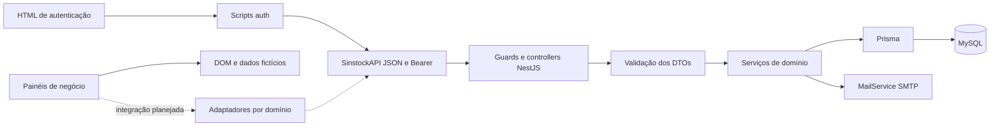

# Análise de coesão entre frontend e backend

Data: 04/11/2026. Escopo: código atual do repositório e aplicação local com MySQL.

**Resultado: o projeto tem uma base técnica utilizável, mas os contratos de negócio ainda não estão coesos para conectar todas as telas diretamente.** Autenticação, sessão, recuperação de senha e cadastro administrativo estão integrados. Os nove painéis de negócio ainda não consomem suas APIs. Há contratos parcialmente compatíveis, funcionalidades sem endpoint e defeitos concretos a corrigir antes da integração operacional.

Esta análise gerou documentação e evidências. Não alterou regras de negócio, telas ou banco; as verificações do backend fizeram login e consultas GET. Os testes de formulários usaram dados sintéticos com requisições de escrita bloqueadas.

## 1. Documentos do levantamento

| Documento | Conteúdo |
|---|---|
| [Matriz de integração](matriz-integracao.md) | Ações de cada tela, endpoints correspondentes, divergências e dependências |
| [Inventário da API](inventario-api.md) | As 79 operações, guards, parâmetros, DTOs e validadores |
| [Inventário do frontend](inventario-frontend.md) | Páginas, scripts, funções nomeadas, listeners e controles dinâmicos |
| [Plano de comunicação](plano-integracao.md) | Decisões de contrato, fases, dependências e critérios de aceite |
| [Inventário da API em JSON](inventario-api.json) | Controllers, serviços/métodos, módulos, DTOs, modelos e enums |
| [Inventário do frontend em JSON](inventario-frontend.json) | Controles, funções, eventos, chamadas HTTP e referências de armazenamento |
| [Verificação HTTP](verificacao-api.json) | Status e formatos das respostas reais, sem tokens nem conteúdo pessoal |
| [Verificação de formulários](verificacao-frontend.json) | Comportamentos de submissão isolados no navegador |
| [Verificação de IDs](verificacao-dom.json) | Referência DOM ausente identificada no estoque |

## 2. Dimensão e integração atual

| Item | Quantidade/estado |
|---|---|
| Páginas HTML | 16 arquivos: 15 telas e um redirecionamento legado de login |
| Painéis de negócio | 9: dashboard, estoque, produtos, fornecedores, pedidos, vendas, relatórios, configurações, ajuda |
| Scripts próprios do frontend | 18; 76 funções nomeadas e 127 registros explícitos de eventos |
| Controllers HTTP | 20 |
| Operações da API | 79, incluindo o GET de SSE |
| DTOs | 41 declarações de classes em 35 arquivos; 39 nomes distintos, com duplicações em notas fiscais |
| Modelos Prisma | 19 |
| Migrações existentes | 5 |
| Operações chamadas explicitamente pelo frontend | 8 combinações de método e caminho |

As oito operações consumidas são:

| Operação | Consumidor |
|---|---|
| `POST /auth/login` | `js/auth/login.js` |
| `GET /auth/me` | `js/auth/session.js`, em todas as páginas protegidas |
| `POST /auth/logout` | `js/auth/session.js`, inclusive logout do dashboard |
| `POST /auth/forgot-password` | `js/auth/forms.js` |
| `POST /auth/reset-password` | `js/auth/forms.js` |
| `POST /auth/2fa/authenticate` | `js/auth/mfa.js` |
| `GET /perfis` | formulário administrativo de cadastro |
| `POST /users` | `pages/cadastro.html`, por administrador |

As outras 71 operações não possuem chamada explícita na interface atual. Isso é uma medida de cobertura de chamadas, **não uma porcentagem de conclusão do produto**: algumas rotas são de suporte ou não precisam de tela própria.

## 3. Estrutura do projeto no diagnóstico original

A árvore abaixo registra a organização anterior. A estrutura vigente, os caminhos corrigidos e a estratégia única de geração do Prisma estão em [arquitetura](arquitetura.md).

```text
backend-sinstock/
  src/
    main.ts                  Bootstrap, validação, CORS, Swagger e frontend estático
    app.module.ts            Composição dos módulos, rate limit e agendamentos
    auth/                    Login, JWT, pré-autenticação, TOTP, recuperação e guards
    usuario/                 Administração e consulta de usuários
    perfis/                  Cadastro/consulta de perfis e permissões em JSON
    categorias/              Cadastro-base dos produtos
    fornecedores/            Cadastro dos fornecedores
    clientes/                Cadastro e consulta de clientes
    filiais/                 Unidades operacionais do estoque e das vendas
    produtos/                Catálogo, preços, mínimo e consulta por código de barras
    saldos-estoque/           Consulta de saldos por produto/filial/lote
    movimentacoes/           Entradas, saídas, ajustes, transferências e histórico
    notas-fiscais-entrada/    Recebimentos, lotes, ajuste e estorno de NF
    pedidos/                 Checkout, reserva, confirmação, cancelamento e expiração
    dashboards/              Agregações de estoque e stream SSE
    alertas/                 Estoque baixo e vencimentos
    notificacoes/            Avisos persistidos e varredura diária
    busca-global/            Busca de produtos, fornecedores, lotes e notas
    chamados/                Suporte e notificações por e-mail
    relatorios/              PDF de movimentações
    auditoria/               Serviço de logs e exportações de auditoria
    integracoes/             CEP, coordenadas e distância entre CEPs
    mail/                    Transporte SMTP
    common/                  Paginação, filtro de exceções, PDF/Excel e arquivos públicos
    prisma/                  Adaptador MariaDB/MySQL e ciclo de conexão
  prisma/
    schema.prisma            Modelo de persistência
    migrations/              Histórico de evolução do banco
    seed.ts                  Seed legado; exige revisão antes de reutilizar
    generated/prisma/        Cliente gerado legado versionado
  frontend/
    index.html               Login principal
    pages/                   Autenticação e nove painéis de negócio
    js/core/                 Configuração de URL e cliente HTTP JSON
    js/auth/                 Login, sessão, MFA e formulários integrados
    js/pages/                Comportamento específico das telas de negócio
    js/shared/               Layout, acessibilidade, menus e modelo local de estoque
    styles/                  Fontes Tailwind
    assets/styles/           CSS compilado
    assets/images/           Imagens
    assets/vendor/           Lucide distribuído localmente
    scripts/                 Build, links e auditoria responsiva
  scripts/                   Bootstrap administrativo e verificação SMTP
  test/                      Integração de autenticação HTTP/navegador
  docs/                      Documentação e este levantamento
  .env                       Configuração local; não versionada
  .tmp/                      Artefatos locais e credenciais de desenvolvimento; ignorados
```

O fluxo real integrado é `HTML → scripts auth → SinstockAPI → controller/guard/DTO → service → Prisma → MySQL`. Nos painéis de negócio, o fluxo termina predominantemente no DOM, em arrays de demonstração, `console.log`, `alert` e toasts.



### Modelo de dados e dependências

| Modelo | Papel e relações principais |
|---|---|
| `categorias` | Classifica `produtos` |
| `fornecedores` | Origem das `notas_fiscais_entrada`; sem relação direta de cadastro com produto |
| `produtos` | Catálogo ligado a categoria, lotes, saldos, itens e logs |
| `filiais` | Contexto de saldos, logs e pedidos; não é um cadastro completo da empresa |
| `lotes` | Número/validade por produto; filial é alcançada via saldo |
| `saldos_estoque` | Produto + filial + lote opcional; quantidade total e reservada |
| `notas_fiscais_entrada` | Fornecedor, usuário, número, datas, total e status; não guarda filial diretamente |
| `itens_entrada` | Produto/lote, quantidade e custo ligados à NF |
| `logs_movimentacoes` | Histórico operacional por produto/filial/lote/usuário, com saldos anterior/atual |
| `clientes` | Cadastro associado opcionalmente aos pedidos |
| `pedidos_venda` | Pedido/venda/reserva por filial/usuário/cliente; total, status e expiração |
| `itens_venda` | Produto/lote, quantidade e preço por pedido |
| `usuarios` | Identidade, perfil, status, senha, TOTP e versão de sessões |
| `perfis` | Nome e permissões em JSON; a autorização atual não interpreta todas essas permissões |
| `PasswordResetToken` | Token de recuperação como hash, validade, uso e usuário |
| `chamados_suporte` | Chamado com usuário opcional, e-mail, assunto, prioridade e status |
| `faq` | Perguntas/respostas; ainda sem API |
| `notificacoes` | Avisos e estado lido global; não possui destinatário por usuário |
| `LogAuditoriaEstoque` | Auditoria adicional com ação/recurso/autor/metadados; interceptor ainda desacoplado |

O encadeamento operacional depende de criar categorias/filiais e catálogo antes de receber saldo, reservar ou vender. Na base local consultada, esses cadastros operacionais estão vazios; usuários/perfis já existem para autenticação.

### Organização que pode ser preservada

- Separação NestJS por domínio, com controllers, services e DTOs.
- Cliente HTTP centralizado, URL configurável, erros de autenticação e cancelamento de solicitações.
- Frontend estático servido pelo próprio backend, sem necessidade imediata de SPA ou outro framework.
- Fontes Tailwind separadas dos arquivos compilados e verificações de referências locais.
- Sessão verificada no servidor, senha com hash, token temporário de recuperação armazenado como hash e revogação por versão.
- Transações já usadas em operações relevantes; precisam ser reforçadas quanto a concorrência e consistência de saldos.

### Organização a ajustar

- Não existe camada `frontend/js/services/` para os domínios: os handlers das páginas misturam formulário, regras, renderização e dados fictícios.
- `pedidos.js` tem 2.557 linhas e reúne busca, paginação, modal, cálculos e alteração de status; a divisão deve acompanhar a integração.
- `stock-model.js` define um modelo local e armazenamento genérico, mas a tela de estoque não chama suas funções. Não existe persistência local funcional apenas por carregar esse arquivo.
- O gerador Prisma atual usa `node_modules/@prisma/client`, enquanto `tsconfig.json` aponta para `src/generated/prisma`, inexistente, e 21 arquivos legados permanecem em `prisma/generated`. Deve haver uma única estratégia de geração.
- README recomenda Node 18, mas as dependências instaladas exigem Node 20+ e Prisma aceita `^20.19`, `^22.12` ou `>=24.0`. Também recomenda `db push`/seed em vez do fluxo atual por migrações.
- O seed legado atualiza a senha de um administrador em caso de duplicidade. O bootstrap local existente é separado e não deve ser confundido com esse seed.
- `test:e2e` referencia `test/jest-e2e.json`, ausente no checkout. A suíte real de autenticação usa `test:auth`.

## 4. Resultado por tela

| Tela/fluxo | Compatibilidade atual | Resultado |
|---|---|---|
| Login principal e redirecionamento legado | Contratos correspondentes | Integrado |
| Esqueci senha, aviso de envio e redefinição | Contratos correspondentes | Integrado; entrega real validada anteriormente |
| Código do autenticador | `POST /auth/2fa/authenticate` | Integrado para contas com 2FA já habilitado |
| Cadastro administrativo | `GET /perfis`, `POST /users` | Integrado; manter como fluxo principal |
| Dashboard | API retorna métricas de estoque, UI apresenta vendas/faturamento | Parcial em conceito; sem integração |
| Estoque | APIs de saldo, movimentos, NF e alertas existem | Contratos incompletos e formulário quebrado |
| Produtos | CRUD existe; formulário contém campos sem persistência | Parcial; sem integração |
| Fornecedores | CRUD existe; formulário excede o cadastro disponível | Parcial; sem integração |
| Pedidos | Reserva/checkout/cancelamento existem; estados e dados diferem | Parcial; sem integração |
| Vendas | Pode compartilhar domínio `pedidos`; faltam pagamento, desconto e métricas | Parcial; sem integração |
| Relatórios | PDF de movimentos e exports de auditoria existem | Não cobrem os quatro painéis analíticos da UI |
| Configurações | Usuários parcialmente atendidos; demais configurações sem API | Majoritariamente sem contrato |
| Ajuda/suporte | Chamados existem, FAQ não tem API | Parcial; sem integração |

O detalhamento por ação está na [matriz](matriz-integracao.md).

## 5. Incompatibilidades e defeitos

As evidências abaixo distinguem comportamento reproduzido de análise estática. Prioridade P0 impede confiar nos dados operacionais; P1 bloqueia ou torna incompleta uma funcionalidade; P2 é padronização/manutenção. A prioridade indica ordem de trabalho para a integração, não classificação formal de vulnerabilidade.

### P0 — Fluxo de estoque do frontend não está implementado corretamente

Fontes: [estoque.js](../frontend/js/pages/estoque.js), [estoque.html](../frontend/pages/estoque.html), [stock-model.js](../frontend/js/shared/stock-model.js).

- `movementProduct` só contém a opção vazia e não há carregamento dos produtos.
- O handler acessa `document.getElementById('movementObservation').value`, mas esse elemento não existe no HTML.
- O modelo local é carregado, mas não é utilizado para preencher produtos, salvar ou listar movimentações.
- Reprodução isolada: zero opções de produto; ao despachar o handler, ocorre `Cannot read properties of null (reading 'value')`.

Não é correto afirmar que a tela de estoque tem movimentação local funcional. A responsividade e a navegação passaram em seus testes; esses testes não validavam a submissão operacional.

### P0 — Recebimento/estorno de NF não preserva integralmente filial e lote

Fonte: [notas-fiscais-entrada.service.ts](../backend/src/notas-fiscais-entrada/notas-fiscais-entrada.service.ts), métodos `criar`, `estornar`, `ajustarLote`.

- O recebimento procura o saldo por produto/filial sem filtrar lote e cria saldo sem `lote_id`, embora o item de entrada e seu log possam ter lote.
- O estorno procura saldo apenas por produto, sem filial/lote.
- O log do estorno usa campos `tipo` e `descricao`, inexistentes no modelo atual, e omite campos obrigatórios como `filial_id`, `tipo_movimentacao`, `saldo_anterior` e `saldo_atual`; `as any` oculta a incompatibilidade do compilador.
- O ajuste de quantidade no item de entrada não reconcilia os saldos, logs e total da nota.
- O autor da NF vem do corpo (`usuario_id`) e não da identidade autenticada.

São incompatibilidades verificadas no código/schema; não executei recebimentos ou estornos no banco real. Devem ter testes com dados isolados antes de habilitar as ações.

### P0 — Operações de estoque precisam respeitar reserva e concorrência

Fontes: [movimentacoes.service.ts](../backend/src/movimentacoes/movimentacoes.service.ts) e [pedidos.service.ts](../backend/src/pedidos/pedidos.service.ts).

- Saída manual e transferência comparam o saldo total e não descontam `quantidade_reservada`; ajuste pode reduzir o total abaixo do reservado.
- Diversos fluxos leem o saldo e depois gravam valores absolutos. A existência de `$transaction` não demonstra, por si, que duas requisições concorrentes não perdem atualizações.
- Confirmação/cancelamento leem status antes da transação, sem uma transição condicional demonstrada no código. Confirmar/cancelar/expirar concorrentemente precisa de proteção e testes.

Reserva ignorada é evidência de código. Corridas concorrentes são riscos identificados pelo padrão de leitura/escrita, ainda não reproduzidos; não afirmo que houve corrupção de dados.

### P1 — Alertas filtrados por filial falham

Fonte: [alertas.service.ts](../backend/src/alertas/alertas.service.ts), `verificarLotesVencimento`.

`lotes` não possui `filial_id`; a filial deve ser relacionada via `saldos_estoque`. Reproduzido: `GET /alertas/vencimentos?filial_id=1` e `GET /alertas?filial_id=1` retornam 500. As consultas sem filtro retornam 200.

### P1 — Cadastros mostram sucesso sem persistir

Fontes: [produtos.js](../frontend/js/pages/produtos.js), [fornecedores.js](../frontend/js/pages/fornecedores.js), [vendas.js](../frontend/js/pages/vendas.js), [configuracoes.js](../frontend/js/pages/configuracoes.js), [ajuda.js](../frontend/js/pages/ajuda.js).

Há `alert` de sucesso e alterações apenas no DOM sem chamada de API. Na reprodução isolada, produto e alteração de senha em Configurações exibiram sucesso com zero tentativas de escrita. Os submits foram despachados programaticamente para inspecionar os handlers, sem caracterizar a validação HTML completa.

A alteração de senha funcional é a recuperação por link. O formulário de alteração de senha em Configurações é outro fluxo e ainda não altera a senha.

### P1 — Campos dos produtos não cabem no contrato atual

Fonte: [CreateProdutoDto](../backend/src/produtos/dto/create-produto.dto.ts), modelo `produtos` e handler de cadastro.

- Correspondem: `nome`; `categoria → categoria_id`; `codigoBarras → codigo_barras`; `custo → custo_medio`; `preco → preco_venda`; `estoqueMinimo → estoque_minimo`.
- Faltam no contrato: descrição, SKU, unidade, status ativo/inativo, observação e vínculo direto com fornecedor.
- Estoque inicial deve ser uma movimentação por filial/lote, não uma quantidade enviada junto do produto sem registro de origem.
- Validade pertence a lote, que também exige número de lote; não é atributo único do produto.
- Categoria exibida como texto/slug deve ser trocada pelo ID real.

Com `forbidNonWhitelisted=true`, enviar o objeto atual inteiro não funciona: campos extras serão recusados. Descartá-los silenciosamente também não atende ao formulário.

### P1 — Fornecedores possuem campos e filtros sem persistência

Fonte: [CreateFornecedorDto](../backend/src/fornecedores/dto/create-fornecedor.dto.ts) e [fornecedores.js](../frontend/js/pages/fornecedores.js).

`razaoSocial` deve mapear para `nome_juridico`, `uf` para `estado`; a máscara de CNPJ precisa de normalização consistente. Nome fantasia, inscrição estadual, contato, categoria, prazo, condição de pagamento, status e observações não estão no contrato atual. A listagem não possui paginação/filtros de servidor.

### P1 — Pedidos e vendas não compartilham o mesmo contrato funcional

Fontes: [pedidos.js](../frontend/js/pages/pedidos.js), [vendas.js](../frontend/js/pages/vendas.js), [CreateCheckoutDto](../backend/src/pedidos/dto/create-checkout.dto.ts) e enum `pedidos_venda_status`.

- UI: pendente, em separação, enviado, concluído e cancelado. Backend: `ORCAMENTO`, `CONCLUIDO`, `CANCELADO`.
- `ORCAMENTO` representa reserva com expiração; não pode ser tratado automaticamente como pedido pendente sem decidir a regra.
- UI usa nomes de cliente/produto e preços fixos. API requer IDs reais, filial e itens com quantidade/preço unitário.
- Pagamento, desconto e observações não são persistidos no pedido atual.
- Não há rota genérica para editar pedido ou definir separação/envio. Há confirmar reserva e cancelar.
- A lista é array não paginado, sem os filtros de período/status/pagamento da interface.
- Preço é recebido do cliente. Definir se pode ser editado pelo operador ou precisa de validação contra o catálogo; desconto/total devem ser calculados e conferidos pelo servidor.

### P1 — Relatórios e dashboard apresentam métricas diferentes das APIs

O dashboard fornece distribuição de estoque por categoria, entradas/saídas da semana e produtos críticos. A tela apresenta faturamento, vendas e pedidos com gráficos fictícios de 7/30 dias/mês.

A tela de relatórios possui visão geral, vendas, estoque e movimentações; suas ações atuais são filtros locais sem consulta, exportação CSV do HTML e `window.print()`. O backend oferece PDF de movimentações e PDF/Excel de auditoria; não existem os endpoints agregados equivalentes aos quatro painéis, ranking e distribuição por pagamento.

### P1 — Configurações e gestão de permissões incompletas

- Cadastro administrativo real já existe em `cadastro.html`; o modal duplicado de Configurações só adiciona uma linha local e não usa a senha informada.
- `GET /users` e `PATCH /users/:id` podem atender parte da gestão; “último acesso” não existe no schema atual.
- Dados da empresa, configurações de estoque, preferências, exportação geral e encerramento por inatividade não têm contratos/persistência correspondentes.
- `POST /perfis` cria permissões, mas não existe atualização de perfil. `RolesGuard` compara IDs numéricos; não interpreta a matriz de permissões em JSON.
- Somente quatro operações têm `@Roles(1)`: criar perfil, criar usuário, editar usuário e alternar status. Demais acessos dependem basicamente de JWT; definir a política exigida pelos perfis da UI.
- Para alterar a própria senha, não reutilizar uma rota administrativa como se todos os usuários tivessem acesso. Falta contrato de senha atual + nova senha do usuário autenticado.

### P1 — 2FA possui autenticação, mas falta o fluxo de configuração na UI

Existem gerar segredo/QR, habilitar e autenticar. A tela de código só realiza a última etapa. Faltam interface de ativação, confirmação e política/contrato de desativação/recuperação. Gerar novo segredo para uma conta já habilitada também exige uma regra explícita para não perder a configuração anterior prematuramente.

### P1 — Suporte e FAQ não correspondem integralmente à tela

- UI usa `assunto`; API exige `titulo`, `descricao`, `prioridade`, `emailSolicitante`.
- Prioridades devem ser convertidas para `BAIXA`, `MEDIA`, `ALTA`, `CRITICA`; “Normal” precisa de tradução definida para `MEDIA`.
- Categoria, página e anexo não têm persistência/contrato atual. Não há upload configurado para o arquivo da tela.
- Modelo `faq` existe, mas não há controller/serviço de FAQ.
- `POST /chamados` é público e envia confirmação por e-mail; listagem/status exigem JWT, mas não há escopo por solicitante. A criação não associa `usuario_id`.
- Status é recebido sem DTO de validação próprio. Código aleatório de quatro dígitos pode colidir com a restrição única; é necessário definir geração confiável.

Decidir se suporte será interno ou público. Não executei criação de chamado nem envio de e-mail nesta auditoria.

### P1 — Eventos e auditoria existem como infraestrutura, mas não estão ligados

- `DashboardService.notificarMovimentacao` não tem chamadas no restante de `src`: o stream SSE não é alimentado pelas movimentações.
- O frontend atual usa JWT no header; o transporte de eventos precisa suportar essa autenticação. Não colocar JWT na URL como solução automática.
- Interceptor/decorator de auditoria não estão aplicados aos controllers nem registrados como interceptor global. Exportar auditoria não garante que eventos foram registrados.
- O interceptor procura `user.id`/`user.sub`, mas a estratégia JWT retorna `user.userId`; ao habilitá-lo, alinhar o autor do log.
- Não confundir `logs_movimentacoes` (registro operacional, usado pelos serviços) com `logs_auditoria_estoque` (auditoria adicional ainda desacoplada).

### P1/P2 — Filtros e tipos não são uniformes

- `apenas_estoque_baixo=false` vira `true` com a transformação atual `@Type(() => Boolean)`; confirmado com `plainToInstance` do DTO compilado. Uma base vazia não evidencia isso visualmente no GET.
- O filtro de produtos usa quantidade `<= 10`, em vez do mínimo do produto e do saldo disponível. Os outros serviços também variam entre soma total, saldo por lote e saldo disponível.
- `data_inicio`/`data_fim` são aceitos no DTO de produtos, mas não são usados na consulta.
- Manual de movimentação exige quantidade inteira e mínima 1; o modelo local prevê ajuste a zero, o formulário atual não implementa esse fluxo corretamente e o schema armazena três casas decimais. Definir precisão e semântica por operação.
- `observacao` é aceita no DTO de movimento/transferência, mas não é persistida nos logs atuais. Data/motivo/fornecedor/referência da UI também precisam de destino definido.
- Histórico de movimentos recebe parâmetros escalares sem os limites de um DTO. `limit=-1` foi aceito com 200 em base vazia; o comportamento deve ser validado/limitado explicitamente.
- `PATCH /filiais/:id` usa `Partial<CreateFilialDto>`, tipo TypeScript que não fornece a validação em runtime de um DTO concreto.
- Notas fiscais possuem duas versões de `CreateItemEntradaDto`/`CreateLoteDto`; a versão usada pela nota tem validações de quantidade/custo mais fracas.

### P2 — Paginação, formatos e downloads exigem adaptação

| Domínio | Formato atual |
|---|---|
| Produtos | `{ dados, meta: { total, pagina, limite, totalPages, hasNextPage, hasPreviousPage } }` |
| Clientes e saldos | `{ data, meta: { totalItems, itemCount, itemsPerPage, totalPages, currentPage } }` |
| Auditoria (serviço) | `{ data, meta: { total, page, limit, totalPages } }` |
| Fornecedores, categorias, filiais, pedidos, usuários, perfis, notificações, chamados, NF | Arrays, sem paginação nesses controllers |
| Movimentações | Array, com limite e filtros específicos |

Além de padronizar envelopes, transformar `Decimal`, datas, IDs numéricos e IDs `BigInt` serializados para string de forma explícita. O cliente HTTP atual só aceita JSON: PDFs/Excel precisam de um método para `Blob` com tratamento de erros e headers de download.

## 6. Backend sem tela/ação equivalente

- Categorias: há CRUD, mas nenhuma tela de manutenção; produtos dependem desse cadastro.
- Filiais: há CRUD e é dependência obrigatória de saldo/pedido; falta seleção/contexto na UI.
- Clientes: há criação, lista e edição, mas apenas opções fictícias nos formulários comerciais. `remove` existe no serviço, sem rota `DELETE` no controller.
- Notas fiscais/lotes/estorno/transferência: há APIs, sem fluxo completo na interface atual.
- Código de barras: API disponível, sem ação de consulta/scanner integrada.
- Integrações CEP/coordenadas/distância: APIs sem consumidor nas telas.
- Alertas e notificações: APIs existentes; sinos/menus atuais mostram dados locais ou avisos de demonstração.
- Auditoria: exportações disponíveis; não há consulta JSON pública de histórico de auditoria nem tela dedicada.

## 7. Verificações e limites da conclusão

- Inventário estático: 79 operações; Swagger local também informou 79 operações.
- 27 consultas GET autenticadas: 24 retornaram 200, duas retornaram 500 (alertas com filial), uma retornou 404 para ID deliberadamente inexistente.
- `GET /produtos` sem token retornou 401.
- Consulta real identificou listas vazias de categorias, fornecedores, clientes, filiais, produtos, saldos, pedidos, notas, chamados e notificações. Não é possível validar um ciclo operacional preenchido a partir dessas respostas.
- Build do backend e verificação de frontend passaram; 12 folhas CSS e 231 referências locais verificadas.
- Testes de autenticação, responsividade e recuperação real já foram executados nas etapas anteriores; não equivalem a testes de todos os CRUDs e regras de negócio.
- Nesta auditoria não foram executados checkout, reserva, cancelamento, recebimento, estorno, criação de chamados, varredura de notificações ou integrações externas. Os respectivos achados são revisão de código/contrato, não afirmações de execução bem-sucedida.

## 8. Decisão de prontidão

**Pronto para preservar:** autenticação integrada, infraestrutura Nest/Prisma, cliente HTTP base e layouts responsivos.

**Pronto para iniciar após contrato mínimo:** categorias, filiais, clientes, fornecedores e catálogo, com campos decididos e IDs reais.

**Ainda bloqueado para uso operacional confiável:** movimentação, recebimento/estorno, reservas/vendas e métricas derivadas, até resolver consistência dos dados e incompatibilidades de contrato.

O próximo passo recomendado é a fase 0 do [plano](plano-integracao.md): corrigir bloqueios e fechar os contratos. A integração por tela deve seguir as dependências e critérios de aceite, sem substituir sucesso de banco por sucesso visual no navegador.
